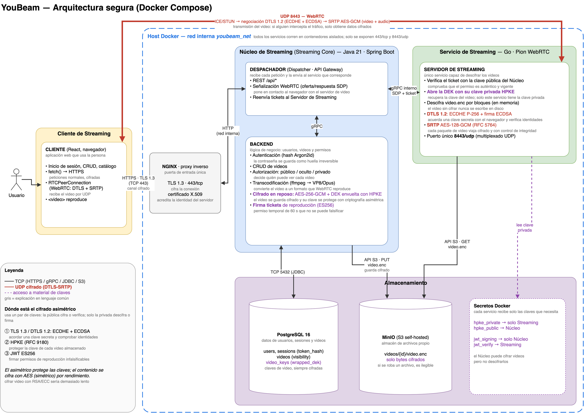
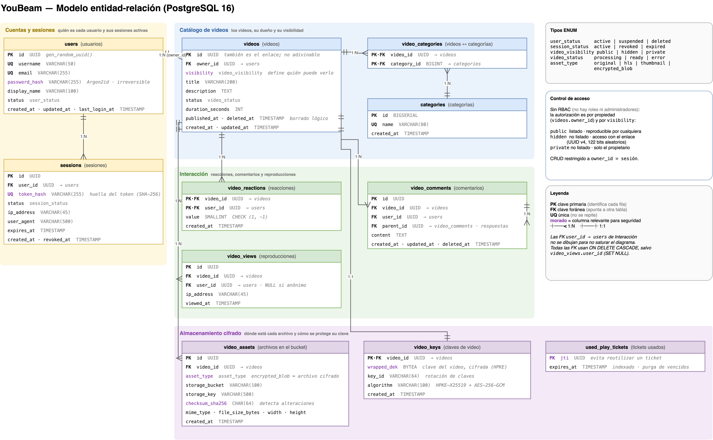
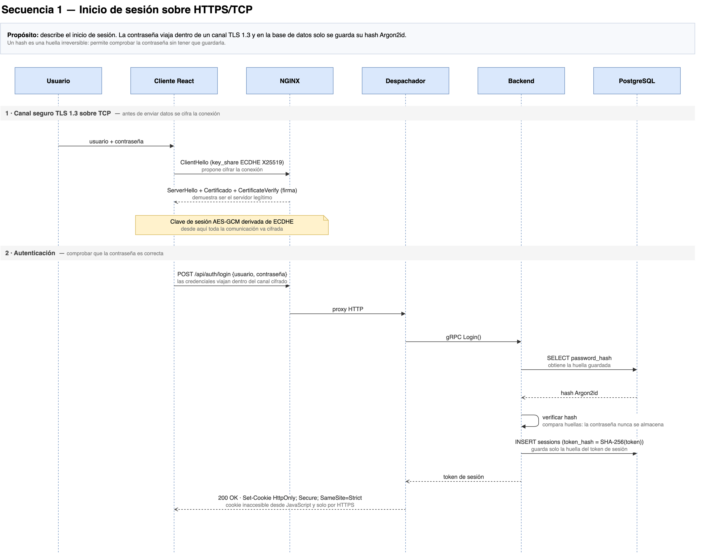
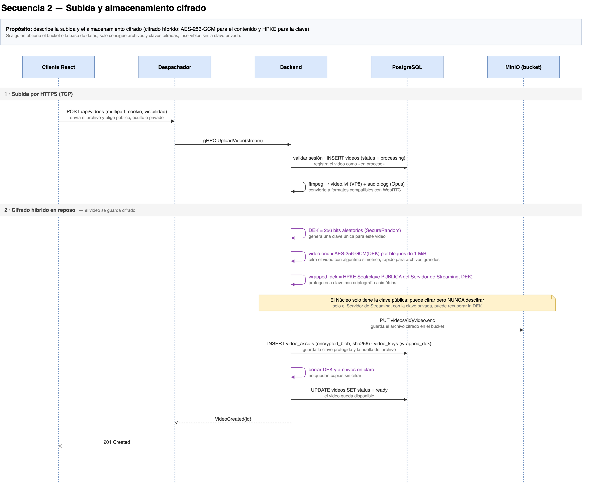
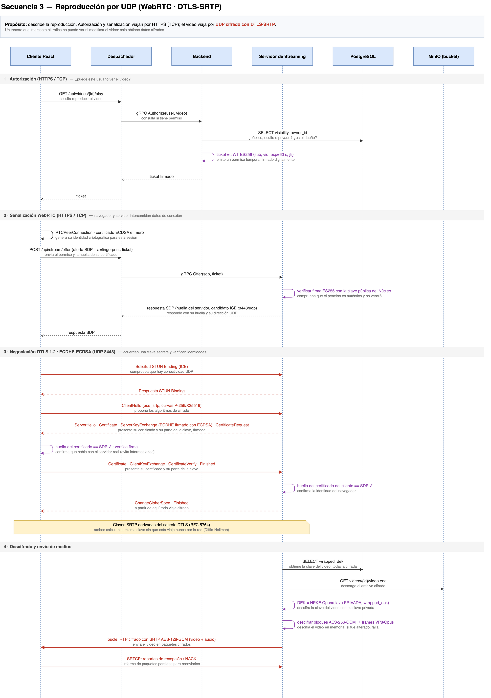

# YouBeam

Plataforma de streaming de video con transmisión cifrada por **UDP** y almacenamiento cifrado
con **criptografía asimétrica**, construida como monorepo para la materia de Seguridad Informática.

- **Transmisión**: WebRTC sobre UDP con **DTLS-SRTP** (ECDHE P-256 + certificados ECDSA).
- **Almacenamiento**: cada video se cifra con una clave propia (AES-256-GCM) que se envuelve con
  **HPKE** (X25519) usando la clave pública del Streaming Server. El bucket y la base de datos solo
  guardan datos cifrados.
- **Autorización**: videos públicos, ocultos o privados; reproducción con tickets **JWT ES256** de
  corta duración y protección contra replay.
- **Tráfico TCP** (login, CRUD, señalización): **TLS 1.3** en NGINX.

## Arquitectura



| Componente | Tecnología | Carpeta |
|---|---|---|
| Cliente | React + Vite | `services/youbeam_client` |
| Core (API, autenticación, subida cifrada) | Java 21, Spring Boot 3, Google Tink | `services/youbeam_core` |
| Streaming Server | Go, Pion WebRTC v4, Google Tink | `services/youbeam_stream` |
| Base de datos | PostgreSQL 16 | `deploy/db_init` |
| Bucket self-hosted | MinIO (API S3) | `deploy/` |
| Proxy TLS | NGINX | `deploy/nginx` |

## Base de datos



## Diagramas de secuencia

### Inicio de sesión (TCP / TLS 1.3)



### Subida cifrada (HPKE + AES-GCM)



### Reproducción por UDP (DTLS-SRTP)



El archivo editable con todos los diagramas está en
`docs/diagrams/structural diagram video platform.drawio`.

## Estructura del repositorio

```
youbeam/
├── deploy/            # Docker Compose, NGINX, esquema SQL
│   └── db_init/db.sql
├── docs/              # Diagramas y recursos
├── services/
│   ├── youbeam_client/   # Frontend React
│   ├── youbeam_core/     # Backend Spring Boot
│   └── youbeam_stream/   # Streaming Server Go
└── README.md
```

## Base de datos local

La base de datos usa PostgreSQL y se levanta mediante Docker Compose:

```bash
cd deploy
cp .env.example .env
docker compose up -d database
```

El esquema de `deploy/db_init/db.sql` se ejecuta automáticamente la primera vez
que se crea el volumen `youbeam_postgres_data`. Para comprobar el estado del
contenedor:

```bash
docker compose ps
docker compose logs database
```

Para conectarse desde el equipo local (puerto definido en `POSTGRES_PORT`, por defecto 5432):

```bash
psql -h localhost -p 5432 -U youbeam -d youbeam
```

Si se modifica `db.sql` y se necesita ejecutarlo de nuevo desde cero, hay que
eliminar el volumen de desarrollo:

```bash
docker compose down -v
docker compose up -d database
```

## Levantar todo el stack (desarrollo)

```bash
scripts/dev-up.sh            # equivale a docker compose up -d, con PUBLIC_IP detectada
scripts/dev-up.sh --build    # reconstruyendo las imágenes
```

El script anuncia como candidato ICE la IP de la interfaz física (Wi-Fi/Ethernet) e ignora las
VPN. Hay que volver a ejecutarlo **cada vez que el equipo cambie de red**. Abrir la plataforma en
`https://localhost`.

> **Firefox y VPN:** con una VPN de sistema activa (WireGuard, etc.), Firefox solo usa la
> interfaz del túnel para WebRTC y no puede llegar a un servidor que corre en la misma máquina
> (`ICE failed`). En local, desactivar la VPN para probar con Firefox o usar Chrome. No afecta
> a un despliegue con IP pública.

## Flujo de trabajo

Cada integrante trabaja en su propia rama y nadie hace push directo a `main`.

| Integrante | Rama | Área |
|---|---|---|
| @marcelopcx | `dev/marcelopcx` | Backend (Core) + bucket MinIO |
| @arrias24 | `dev/arrias24` | Frontend |
| @luiscab19 | `dev/luiscab19` | Streaming Server |
| @JhonmarMorales17 | `dev/jhonmarmorales17` | Infraestructura |

1. `git fetch origin && git checkout dev/<usuario>`
2. Commits pequeños en la rama propia y `git push origin dev/<usuario>`
3. Antes de integrar: `git merge origin/main` en la rama y resolver conflictos
4. Abrir un **Pull Request hacia `main`**

Las tareas de cada área están en los [issues](https://github.com/nullcipher-sec/Youbeam/issues).

> Las claves privadas (`deploy/secrets/`) y los archivos `.env` nunca se suben al repositorio.
